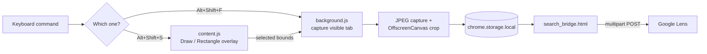

<div align="center">



<br>

[](https://github.com/Aman-nitb-cse/circle-to-search/stargazers)
[](https://github.com/Aman-nitb-cse/circle-to-search/network/members)
[](https://github.com/Aman-nitb-cse/circle-to-search/issues)
[](https://github.com/Aman-nitb-cse/circle-to-search/commits)


<!--
Chrome Web Store users / rating badges: after you publish, replace YOUR_EXTENSION_ID and uncomment.

[](https://chromewebstore.google.com/detail/YOUR_EXTENSION_ID)
[](https://chromewebstore.google.com/detail/YOUR_EXTENSION_ID)
-->

**Circle anything on your screen. Search it with Google Lens. One shortcut.**

[Install](#-install) · [Usage](#-usage) · [Features](#-features) · [How it works](#-how-it-works) · [Contribute](#-contributing)

</div>

---



---

## ✨ Features

| | |
|---|---|
| ✏️ **Draw mode** | Circle anything with a freehand stroke, like Circle to Search on Android. |
| ▭ **Rectangle mode** | Drag a precise box around the part of the page you want to search. |
| 🖥️ **Full-screen search** | One shortcut captures the whole visible tab and sends it straight to Google Lens. |
| 💬 **Default prompt** | Add up to 300 characters of text that is sent with every search (for example *"find similar products"*). Toggle it on or off anytime. |
| 🌗 **Auto / Light / Dark** | The popup and the on-page toolbar follow your system theme, or you can pick one manually. |
| ⚡ **Fast** | The screenshot is a JPEG, cropped inside the background service worker with `OffscreenCanvas`. |
| 🔒 **Minimal permissions** | Only `activeTab`, `storage` and `scripting`. No access to all websites. |

## 📦 Install

> Works on Chromium-based browsers that support Manifest V3 (Chrome, Edge, Brave, Opera, …).

**From source (developer mode)**

1. Download or clone this repository.
   ```bash
   git clone https://github.com/Aman-nitb-cse/circle-to-search.git
   ```
2. Open `chrome://extensions` and turn on **Developer mode**.
3. Click **Load unpacked** and select the project folder (the one that contains `manifest.json`).
4. Pin the extension from the puzzle-piece menu so the popup is one click away.

## 🚀 Usage

1. Press a shortcut on any normal web page.
2. **Draw** a loop or **drag** a rectangle around what you want to search.
3. Google Lens opens in a new tab with your selection (and your prompt, if enabled).

| Action | Windows / Linux | macOS |
|---|---|---|
| Select an area (Rectangle / Draw) | <kbd>Alt</kbd> + <kbd>Shift</kbd> + <kbd>S</kbd> | <kbd>⌘</kbd> + <kbd>Shift</kbd> + <kbd>X</kbd> |
| Search the full screen | <kbd>Alt</kbd> + <kbd>Shift</kbd> + <kbd>F</kbd> | <kbd>⌘</kbd> + <kbd>Shift</kbd> + <kbd>L</kbd> |
| Close the overlay | <kbd>Esc</kbd> | <kbd>Esc</kbd> |

Want different keys? Click a shortcut in the popup, or open `chrome://extensions/shortcuts`.

> [!NOTE]
> Chrome does not allow extensions to run on some pages (for example `chrome://` pages and the Chrome Web Store). Shortcuts will not work there.

### Popup settings

| Setting | What it does |
|---|---|
| **Mode** | Choose whether the overlay starts in *Draw* or *Rectangle*. |
| **Prompt** | Optional text (max 300 chars) sent to Lens with every search, with an on/off switch. |
| **Appearance** | Auto, Light or Dark. |
| **Shortcuts** | Shows the current keys and links to the browser's shortcut settings. |

## ⚙️ How it works



| File | Role |
|---|---|
| `manifest.json` | MV3 manifest, permissions and the two keyboard commands. |
| `background.js` | Service worker: handles commands, captures the tab, crops the image, opens the bridge page. |
| `content.js` | Injected on demand: selection overlay with Draw / Rectangle and the floating toolbar. |
| `search_bridge.html` / `.js` | Builds the upload form and posts the image (plus prompt) to Google Lens. |
| `popup.html` / `.js` | Settings UI: mode, prompt, theme and shortcuts. |

## 🔐 Privacy

- The image you select is sent to **Google Lens only**, the same as if you uploaded it there yourself.
- The extension has **no analytics or tracking code** and talks to no server of its own.
- Settings (mode, prompt, theme) are kept in `chrome.storage.local` on your device.
- The temporary capture is removed from storage as soon as the search tab reads it.

## 📈 Community & Stats

<div align="center">

[](https://star-history.com/#Aman-nitb-cse/circle-to-search&Date)

<br>


</div>

All the numbers above update automatically. If this project saves you time, a ⭐ helps others find it.

## 🤝 Contributing

Bug reports and ideas are welcome.

1. [Open an issue](https://github.com/Aman-nitb-cse/circle-to-search/issues/new) and describe the problem or idea.
2. Fork the repo and create a branch: `git checkout -b feat/my-idea`.
3. Load the folder as an unpacked extension and test your change.
4. Open a pull request.

## 🙏 Credits

Inspired by Circle to Search on Android. Visual search is powered by [Google Lens](https://lens.google.com). This project is an independent extension and is not affiliated with or endorsed by Google.

<div align="center">
<sub>Made with 💜 by <a href="https://github.com/Aman-nitb-cse">Aman</a></sub>
</div>
