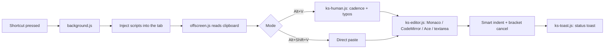

 

**Type or paste clipboard code into any web editor, with smart indent and bracket handling.**

[Install](https://chromewebstore.google.com/detail/dpadfcjjnkjabijdiagaadnhnghemdmh) · [Usage](#-usage) · [Features](#-features) · [How it works](#-how-it-works) · [Analytics](#-community--analytics) · [Report a bug](https://github.com/aman-nitb-cse/Coding-keyboard-simulator/issues/new)

---

## ✨ Overview

**Coding Keyboard Simulator** is a lightweight Chrome extension (Manifest V3). Copy some code, click inside an editor, press a shortcut, and the extension either **types it out like a human** or **pastes it instantly**, fixing indentation and auto-closed brackets along the way so the result matches your source exactly.

## 🚀 Features

| | Feature | What it does |
|---|---|---|
| ⌨️ | **Human typing** | Natural keystroke rhythm (~55 WPM) with bursts, word pauses, longer pauses at new lines and `; { }`, and occasional "thinking" breaks. |
| 📋 | **Direct paste** | Drops the clipboard contents into the editor instantly. |
| 📐 | **Smart indent** | Looks at what the editor actually produced after each newline and corrects it, so every line ends with exactly the source indentation (tabs, spaces, auto-indent or none). |
| 🔤 | **Bracket handling** | Cancels the closers that editors auto-insert for `( [ { " ' \`` and HTML tags, so nothing gets doubled. |
| 🙈 | **Human typos** | Occasional QWERTY neighbour-key slips followed by a natural backspace correction. |
| 🛑 | **Esc to stop** | Stop typing at any moment. A toast shows *Typing…*, *Done*, *Clipboard Empty* or *Click inside the editor first*. |
| 🎛️ | **Custom shortcuts** | Rebind both shortcuts from Chrome's own keyboard settings. |
| 🌐 | **Works in common editors** | Plain `<textarea>`, contenteditable, **Monaco**, **CodeMirror** and **Ace** based editors. |

## 📦 Install

1. Open the [**Chrome Web Store page**](https://chromewebstore.google.com/detail/dpadfcjjnkjabijdiagaadnhnghemdmh).
2. Click **Add to Chrome**.
3. Pin the extension to your toolbar for quick access to the popup.

## 🎮 Usage

1. Copy the code you want to insert.
2. **Click inside** the target editor.
3. Press a shortcut:

| Shortcut | Action |
|---|---|
| <kbd>Alt</kbd> + <kbd>V</kbd> | Human typing |
| <kbd>Alt</kbd> + <kbd>Shift</kbd> + <kbd>V</kbd> | Direct paste |
| <kbd>Esc</kbd> | Stop typing |

Want different keys? Open the popup and click **Record Key**, which takes you to `chrome://extensions/shortcuts`.

## 🧠 How it works

| File | Role |
|---|---|
| `manifest.json` | MV3 manifest, shortcuts (`human-type`, `direct-paste`), permissions |
| `background.js` | Handles commands and injects the content scripts |
| `offscreen.html/js` | Reads the clipboard via an offscreen document |
| `content.js` | Typing loop, smart indent, bracket cancel |
| `ks-human.js` | Human keystroke timing and QWERTY typo helpers |
| `ks-editor.js` | Editor detection and text insertion |
| `page-bridge.js` | Page-world bridge for Monaco / CodeMirror / Ace APIs |
| `ks-toast.js` | Shadow-DOM toast notifications |
| `popup.html/js` | Popup UI showing the current shortcuts |

**Permissions:** `activeTab`, `scripting`, `clipboardRead`, `offscreen`. The extension only acts on the tab where you press a shortcut.

## 📊 Community & Analytics

### ⭐ Star history

<a href="https://star-history.com/#aman-nitb-cse/Coding-keyboard-simulator&Date">
  <picture>
    <source media="(prefers-color-scheme: dark)" srcset="https://api.star-history.com/svg?repos=aman-nitb-cse/Coding-keyboard-simulator&type=Date&theme=dark" />
    <source media="(prefers-color-scheme: light)" srcset="https://api.star-history.com/svg?repos=aman-nitb-cse/Coding-keyboard-simulator&type=Date" />
    
  </picture>
</a>

### 👥 Contributors

### 📥 Chrome Web Store & activity

## 🐞 Feedback

Found a bug or want a feature? Click the 🐞 icon in the popup (it opens a pre-filled issue) or [open an issue](https://github.com/aman-nitb-cse/Coding-keyboard-simulator/issues/new). Please include the site/editor you used (e.g. LeetCode, Monaco, CodeMirror) and your Chrome version.

## 🤝 Contributing

1. Fork the repo and create a branch: `git checkout -b feature/my-idea`
2. Make your changes and test them in Chrome
3. Open a pull request

## 📄 License

Add a `LICENSE` file (MIT is a common choice) and update this section.

Made with ⌨️ by [aman-nitb-cse](https://github.com/aman-nitb-cse) · If this helped you, drop a ⭐

